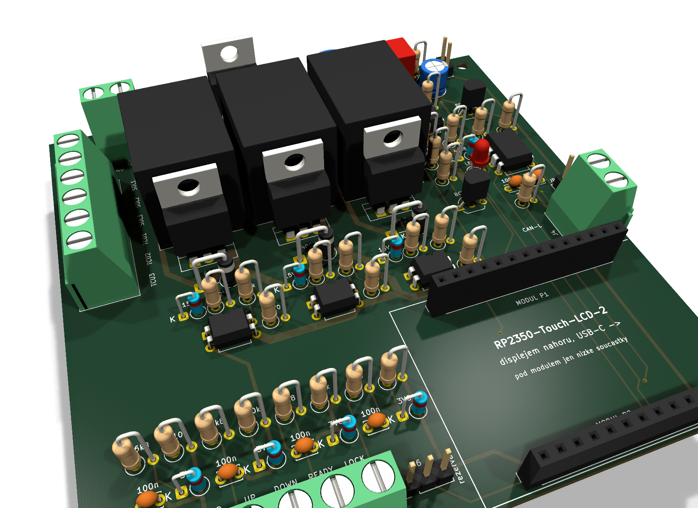

# AW4 shield v0.5 – ovladač automatické převodovky Aisin AW4 s modulem RP2350-Touch-LCD-2

Deska **100 × 100 mm**, SMD součástky osadí **JLCPCB** (Economic PCBA), ručně se pájí vývodové díly (relé, svorkovnice, lišty modulu, měnič, pojistka) a dva SMD díly s velkými pady (C1, D2). Modul **Waveshare RP2350-Touch-LCD-2** (procesor RP2350 + displej 2″ 240×320) se zasouvá **ze spodní strany desky** (displej ven, na výšku, vlevo nahoře) – relé, svorkovnice a měnič jsou na druhé straně, takže displej může být v rovné přední stěně krabičky. Všechny vodiče jdou do svorkovnic **u dolní hrany**. Deska:

* při spínači **READY = vypnuto** nechá původní TCU připojené (převodovka běží jako sériově),
* při **READY = zapnuto** odpojí 3 vodiče solenoidů od původní TCU a převezme je (S1, S2, S3/lockup),
* čte spínače **UP, DOWN, READY, LOCKUP** (5 V, na desce převedeno na 3,3 V); READY a LOCKUP můžou být přímo v krabičce u displeje (zapojit krátkými vodiči do J3),
* **čte napětí na vodičích solenoidů** – při READY vyp. ví, jaký stupeň drží původní TCU (po zapnutí READY za jízdy ho převezme), při READY zap. kontroluje vlastní výstupy,
* má vstup **brzdy** (rozepne lockup) a **rychlosti VSS** (Hall 5/12 V i indukční čidlo, přes komparátor),
* ukazuje zařazený stupeň na displeji modulu (zelená sedmisegmentovka přes celý displej),
* má **CAN** (SN65HVD230) pro hodnoty z rusEFI (rychlost, otáčky, TPS …) – firmware se doplní.



## Co je ve složce

| Cesta | Obsah |
|---|---|
| `kicad/` | **KiCad projekt v0.5** (schéma + PCB), formát KiCad 8, ověřeno v KiCadu 10.0.6 |
| `fab/aw4_shield_gerber.zip` | Gerbery + vrtání pro výrobu DPS |
| `fab/jlc_bom.csv`, `fab/jlc_cpl.csv` | **BOM a pozice součástek pro osazení v JLCPCB** (čísla LCSC) |
| `fab/drc_report.txt`, `fab/erc_report.txt` | výsledky kontrol z KiCadu |
| `bom_objednavka.xlsx` | listy: JLC SMD (díly, typ knihovny, sklad), Ruční osazení (počet desek se dá změnit), Postup, DigiKey |
| `digikey_bom.csv` | ručně pájené díly pro DigiKey BOM Manager |
| `docs/aw4_shield_osazovaci_vykres.pdf` | osazovací výkres s označením součástek |
| `docs/aw4_shield_schema_kicad.pdf`, `docs/aw4_shield_pcb.pdf`, `docs/pcb_*.png` | schéma, výkres DPS, 3D náhledy |
| `firmware/rp2350/` | firmware pro modul RP2350 (+ hotové `.uf2` k přetažení) |
| `tools/` | skripty, kterými se schéma, deska a podklady generují (`pipeline.sh`, `make_bom.py`) |
| `firmware/aw4_controller.ino`, `nextion/`, `docs/v0.3_*` | starší verze s Arduino Nano + Nextion (deska v0.3) |

Předchozí vývodová verze 100 × 100 mm (v0.4) je v historii gitu (commit „AW4 shield v0.4“).

## Objednání

1. **JLCPCB**: nahrát `fab/aw4_shield_gerber.zip`, 2 vrstvy, 1,6 mm, **měď 1 oz stačí**. Zapnout **PCB Assembly** (horní strana) a nahrát `fab/jlc_bom.csv` a `fab/jlc_cpl.csv`.
   * Zvolit **Economic PCBA**. Poplatek za založení dílu (Feeders Loading fee) se platí jednou za objednávku za každý druh dílu mimo knihovnu Basic. Kromě Basic dílů jsou na desce jen 3 druhy: **AOD409** (MOSFET, Extended), **MMSZ5245B** (zenerka 15 V) a **SN65HVD230** (CAN) – oba poslední vede JLC jako Preferred, v přehledu objednávky se ale mohou ukázat jako Extended.
   * C1 (470 µF) a D2 (SMBJ24A) se kvůli poplatku pájí ručně (SMD s velkými pady).
   * V náhledu osazení **zkontrolovat natočení** polarizovaných dílů (diody, optočleny, SOT-23, SOIC-8, D-PAK). JLC to při kontrole také hlídá, ale natočení z KiCadu nemusí u všech pouzder sedět.
   * Sklad dílů ověřený při generování (listopad 2026) je v listu „JLC SMD“; před objednáním zkontrolovat v košíku.
2. **Ruční díly** (list „Ruční osazení“ nebo `digikey_bom.csv`): C1 Panasonic EEE-FK1E471P, D2 SMBJ24A, 3× relé Omron G5LE-1 DC12, svorkovnice Phoenix PT 1,5 (rozteč 3,5 mm), 2× dutinková lišta 1×14, TSR 1-2450, patice TR5 + pojistka 5 A, kolíková lišta + propojka, modul RP2350-Touch-LCD-2.

## Podle servisního manuálu AW-4

* Solenoid se měří mezi **držákem (kostra převodovky) a drátem** → druhý konec solenoidu je na kostře, TCU na drát spíná **+12 V (high-side)**. Výstupy desky jsou proto high-side (P-MOSFET).
* Odpor cívky 11–15 Ω → **0,8–1,25 A na solenoid** (při 14,4 V až 1,3 A). Podle tabulky řazení jsou sepnuté nejvýš 2 solenoidy najednou (~2,6 A).
* Solenoid 1 + 2 řadí stupně, **solenoid 3 = lockup**.
* Ověřit multimetrem na autě: že drátem solenoidu opravdu jde z TCU +12 V a že vodiče S1/S2/S3 jsou správně rozlišené.

| Poloha / stupeň | Solenoid 1 | Solenoid 2 |
|---|---|---|
| P, R, N | ON | OFF |
| 1. | ON | OFF |
| 2. | ON | ON |
| 3. | OFF | ON |
| 4. (OD) | OFF | OFF |

## Jak deska funguje

```
 J1 +12V (zapalování) ─[F1 5A]─[Q1 AOD409, přepólování]─┬─ +12V_SW ─ MOSFETy Q3–Q5 (solenoidy)
                          D2 SMBJ24A (TVS), C1 470µF ──┘     └─[R29 0R]─ +12V_AUX ─ cívky relé, gate, TSR
                                       [U1 TSR 1-2450]─[L1]─ +5V ─[D7 SS14]─ modul (P1-14 5V)
                                                              └─ J3 spínače

 Vodiče solenoidů (3×) ──► K1/K2/K3 (přepínací kontakty SPDT):
        COM ← vodič k SOLENOIDU (J2: SOL1–3)
        NC  ← původní TCU (J2: TCU1–3) … klid = původní TCU řídí (fail-safe)
        NO  ← náš P-MOSFET Q3/Q4/Q5 (+12 V na solenoid)
```

R29 (0 Ω) jen rozděluje +12 V na silovou část se širokými cestami a pomocnou část s tenkými cestami k malým SMD dílům; elektricky je to jeden uzel.

### Stavy relé (fail-safe)

| READY spínač | GPIO21 (modul) | Relé K1–K3 | Solenoidy řídí |
|---|---|---|---|
| vypnuto | cokoli | odpadlé | původní TCU |
| zapnuto | LOW / modul vyjmutý | odpadlé | původní TCU |
| zapnuto | HIGH | přitažené | AW4 (Q3–Q5) |
| výpadek 12 V | – | odpadlé | původní TCU |

LED optočlenu relé (U3) je napájená **přes READY spínač** a do země ji spíná tranzistor Q6 z GPIO21. Vypnutí spínače relé shodí i při zamrzlém firmwaru; bez modulu drží Q6 zavřený rezistor 47 kΩ. Při výpadku modulu drží pull-up 22 kΩ MOSFETy Q3–Q5 zavřené.

## Modul RP2350-Touch-LCD-2 na desce

Modul se zasouvá **ze spodní strany desky, displejem ven, na výšku, USB-C k horní hraně** do dvou dutinkových lišt J7 (P1) a J8 (P2), rozteč 30,48 mm, pin 1 dole. Lišty se osazují zespodu a pájí se shora. Při pohledu na displej je P1 vlevo, při pohledu shora na desku je J7 (P1) vpravo. Sklo displeje přesahuje modul ~10 mm dolů a je ~16 mm od spodní strany desky; na spodní straně nejsou žádné součástky.

| Lišta P1 (J7) | GPIO | Signál |
|---|---|---|
| 1 / 2 / 3 / 4 | 7 / 9 / 8 / 22 | UP / DOWN / READY / LOCKUP (aktivní HIGH, ~3,0 V) |
| 5 | 21 | relé K1–K3 (HIGH = přitáhnout, jen při READY) |
| 7 / 8 / 9 | 23 / 11 / 6 | SOL1 / SOL2 / SOL3 (HIGH = +12 V na solenoid) |
| 10 | 5 | rezerva (J6) |
| 6 / 11 / 12 | 18 / 20 / 19 | displej modulu – **nezapojeno** |
| 13 / 14 | – | GND / 5 V (přes D7) |

| Lišta P2 (J8) | GPIO | Signál |
|---|---|---|
| 1 / 2, 13 | – | 3V3 (napájí CAN budič) / GND |
| 8 / 10 | 1 / 0 | CAN TX / CAN RX (U7 SN65HVD230) |
| 7 / 9 / 11 | 2 / 3 / 4 | čtení napětí na vodičích SOL1 / SOL2 / SOL3 (dělič 22k/6k8: 12 V → 2,8 V) |
| 3 | 28 | brzda (dělič 22k/6k8; na modulu je to i měření baterie, pro pomalý signál nevadí) |
| 12 | 10 | VSS – výstup komparátoru U8 (LM393, práh ~0,6 V s hysterezí) |
| 4, 5, 6 | 29, 13, 12 | dotyk / I2C modulu – **nezapojeno** |
| ostatní | – | nezapojeno |

**Vstupy J5:** 1 = brzdový spínač (+12 V při sešlápnutí, např. z brzdových světel), 2 = signál rychlosti (VSS). Hallovo čidlo s otevřeným kolektorem potřebuje pull-up – když se signál bere z existujícího vodiče k ECU/PCM, pull-up už tam je.

**Programování přes USB jde i při zapojené desce** – 5 V do modulu jde přes Schottkyho diodu D7, takže se napájení z USB a z desky nepřetahují (propojka JP1 z v0.4 už není).

## Součástky

| Ref | Součástka | Funkce | Osazení |
|---|---|---|---|
| J7, J8 | dutinková lišta 1×14 (Sullins PPTC141LFBN-RC) | lišty pro modul | ručně |
| K1, K2, K3 | Omron G5LE-1 DC12 | přepnutí solenoidu mezi původní TCU a desku | ručně |
| U1 | Traco TSR 1-2450 | spínaný stabilizátor 12 → 5 V / 1 A | ručně |
| F1 | patice TR5 + pojistka 5 A | pojistka | ručně |
| J1–J5 | Phoenix PT 1,5 (3,5 mm) | +12 V/GND, SOL/TCU, spínače, CAN, brzda/VSS | ručně |
| R30–R37, D17–D20 | 22k + 6k8, BAV99 | čtení SOL1–3 a brzdy | JLC |
| U8 + R38–R43, D21, D22 | LM393, 1N5819WS, 1N4148WS | vstup rychlosti VSS (komparátor s hysterezí) | JLC |
| Q1, Q3–Q5 | AOD409 (P-MOSFET −60 V, 40 mΩ, D-PAK) | přepólování / high-side spínače solenoidů | JLC |
| Q2, Q6 | MMBT2222A | cívky relé / LED optočlenu relé z GPIO21 | JLC |
| U3 / U4–U6 | LTV-817S (PC817 v SMD) | optočlen relé / optočleny solenoidů | JLC |
| U7 | SN65HVD230 (3,3 V) | CAN budič, J4 = CAN-H/CAN-L, JP2 = zakončení 120 Ω | JLC |
| R3–R10, D3–D6 | 6k8 + 10k, BAV99 | dělič 5 V → 3,0 V, přepětí svede BAV99 do 3V3 / GND | JLC |
| D12, D14, D16 | M7 (1N4007 v SMA) | flyback diody na straně solenoidu (za relé) | JLC |
| D2 | SMBJ24A | transil na napájení | ručně (SMD) |
| C1 | 470 µF / 25 V SMD (EEE-FK1E471P) | zásobní kondenzátor +12 V | ručně (SMD) |
| D1, D11, D13, D15 | MMSZ5245B (15 V) | ochrana gate–source MOSFETů | JLC |
| D7 | SS14 | 5 V do modulu (OR s USB) | JLC |
| R2 | 0 Ω | jediné spojení výkonové (PGND) a logické (GND) země | JLC |

## Deska plošných spojů

* **100 × 100 mm, 2 vrstvy, 1,6 mm, měď 1 oz**, 3× díra M3. Součástky jen na horní straně, spodní strana patří modulu s displejem. Při pohledu ze strany displeje je modul vpravo nahoře. LED READY je na horní straně (ze strany displeje není vidět – stav ukazuje displej).
* Šířky cest: +12 V **1,5 mm** (k MOSFETům), solenoidy/TCU **1,0 mm**, +12V_AUX/+5V/GND/PGND **0,6 mm**, signály 0,3 mm. Spodní vrstva: rozlitá měď PGND (výkonová část vpravo) a GND (logika vlevo), spojené jen přes R2. Při 2,6 A se cesta +12 V ohřeje o ~6 °C, cesta solenoidu (1,3 A) o ~3 °C. Výkonové sítě přecházejí mezi vrstvami jen přes prokovy 0,7–0,8 mm (průřez pokovení větší než průřez cesty).
* Na potisku jsou u ručně pájených dílů označení a hodnoty, u svorkovnic názvy svorek, obrys modulu; SMD díly jsou v osazovacím výkresu.
* Rozvedeno autorouterem (Freerouting). **KiCad 10.0.6: DRC 0 chyb, 0 nepropojených, 0 rozdílů proti schématu, ERC 0 chyb / 0 varování.**

### Před objednáním ověřit
* **Polohu lišt modulu:** výkres Waveshare kótuje rozteč lišt (30,48 mm) a díry, ale ne vzdálenost prvního pinu od kraje modulu – deska počítá s lištami uprostřed (7,59 mm od kraje). Na funkci to nemá vliv, jen na to, jak přesně lícuje obrys na potisku a USB-C s hranou desky.
* Rozvedení z autorouteru stojí za to projít v KiCadu.
* Relé: pinout podle KiCad footprintu G5LE-1 (cívka 2–5, COM 1, NC 4, NO 3).
* Natočení SMD dílů v náhledu JLC.

## Revize zapojení (simulace ngspice, `tools/spice/sim_v05.py`, `toff_v05.cir`)

* **Vstupy:** sepnutý spínač 5 V → **2,97 V** na pinu; 14,4 V omylem na vodiči vstupu svede BAV99 do 3V3 (pin ~3,9 V, proud omezený rezistorem 6k8 na 1,5 mA).
* **Spínání solenoidů:** optočlen z GPIO přes 470 Ω (2,5–3,1 mA); s gate pull-upem 22 kΩ AOD409 spíná naplno (Vgs −11,3 V) i při optočlenu s CTR 25 % a GPIO 3,0 V. Gate se zavře za ~0,3 ms, proud solenoidu klesne za ~1 ms, flyback drží −1 V.
* **Relé:** Q6 (MMBT2222A) z GPIO21 (0,5 mA) sepne LED U3 (9,6 mA), Q2 sepne cívky (0,2 V); při GPIO21 = 0 nebo vyjmutém modulu relé spolehlivě odpadnou.
* **Napájení 5 V:** modul s displejem + optočleny ≪ 1 A z TSR; CAN budič bere 3,3 V z modulu.

Co je potřeba ověřit na autě: polarita solenoidů (+12 V na drát), dobrá zem J1 na kostru, převzetí stupně při zapnutí READY za jízdy (nejdřív vyzkoušet pomalu), že čtení solenoidů odpovídá stupni původní TCU, VSS pulzy, původní TCU po přepnutí zpět může jet v nouzovém režimu do dalšího otočení klíčkem. Blokování podřazení podle rychlosti se doplní po kalibraci VSS.

## Firmware (RP2350)

`firmware/rp2350/uf2/aw4_rp2350.uf2` (pro auto) a `aw4_rp2350_sim.uf2` (simulátor na stole, ovládání ze Serial Monitoru). Nahrání: podržet BOOT, připojit USB, přetáhnout `.uf2` na disk RP2350. Firmware v0.5 navíc: po zapnutí READY za jízdy převezme stupeň, který právě drží původní TCU (ve stoje začíná 1. stupněm); při READY vyp. ukazuje šedě stupeň původní TCU; brzda vždy rozepne lockup; zpětným čtením hlídá výstupy (při nesouladu červeně „CHYBA S1/S2/S3“, zatím jen hlášení). Simulátor má navíc příkazy t (stupeň TCU), b (brzda), v (jede/stojí). Zdrojáky v `firmware/rp2350/aw4_rp2350/`, test logiky + emulátor displeje v `firmware/rp2350/test/`. Menu (podsvícení, lockup, otočení), CAN a měření rychlosti (kalibrace pulzů na km/h) se doplní.

## Původní TCU
Po odpojení (READY zapnuto) vidí původní TCU rozpojený obvod a může si zapsat chybu. Atrapu zátěže na straně TCU nepoužívejte (NC kontakt je v klidu trvale na solenoidu).

## Jak se podklady generují (`tools/`)
`tools/pipeline.sh`: `kgen.py` (schéma, čísla LCSC) → ERC → `build_pcb.py` (rozmístění, netclassy, popisky) → Freerouting → `finish_pcb.py` (zóny) → `cleanup.py` (úklid, tepelné spojky) → `export.sh` (DRC, Gerbery, pozice, PDF, rendery). Seznamy k objednání: `make_bom.py parts.json pos.csv ./` (dotáže se JLC na typ knihovny a sklad). Cesty odpovídají prostředí, kde podklady vznikly.
