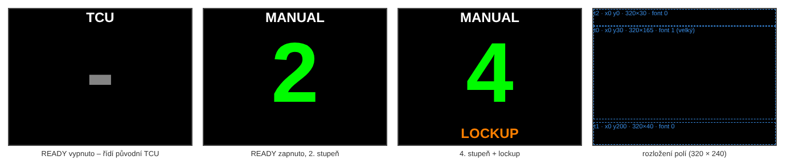

# Displej Nextion NX3224T024 – projekt a nahrání

Displej Nextion má vlastní procesor a vlastní „program" (soubor `.tft`), který se vytvoří v aplikaci **Nextion Editor** (Windows, zdarma na nextion.tech). Arduino pak posílá jen texty do pojmenovaných polí – na displeji se nic nekreslí po pixelech, a proto je odolný proti rušení.

Firmware používá **stránku `page0` a tři textová pole `t0`, `t1`, `t2`**. Názvy musí sedět přesně.

| Pole | Co ukazuje | Barva (posílá Arduino) |
|---|---|---|
| `t2` | režim: `TCU` (řídí původní TCU) / `MANUAL` (READY zapnuto) | bílá |
| `t0` | velké číslo stupně `1`–`4`, nebo `-` | šedá při TCU, zelená při MANUAL |
| `t1` | `LOCKUP`, když je zamčený měnič | oranžová |

## 1. Nový projekt
1. Nextion Editor → **File → New**, uložte jako `aw4_display.HMI`.
2. Výběr zařízení: záložka **Basic**, model **NX3224T024** (2,4″, 320 × 240). Vaše `_011` je varianta s dotykovou vrstvou – dotyk nepoužíváme.
3. **Display Direction: 90° (vodorovně)**, Character encoding: **ascii** (stačí, texty jsou bez diakritiky).

## 2. Fonty (Tools → Font Generator)
Nextion potřebuje fonty vygenerované předem:
1. **Font 0** – výška **24**, písmo Arial, *Bold*, encoding ascii → *Generate font*, uložit jako `f24.zi` → **Add the generated font**.
2. **Font 1** – výška **co největší** (ideálně **128–160 px**; pokud generátor nabízí max. méně, vezměte největší a v kroku 3 zmenšete výšku pole `t0`), Arial *Bold* → uložit `f_big.zi` → Add.

Po přidání musí být v panelu *Fonts* vlevo dole fonty s ID **0** (malý) a **1** (velký).

## 3. Stránka `page0`
Stránka po založení projektu se jmenuje `page0` – nepřejmenovávat. Vlastnost stránky **bco = 0** (černé pozadí).

Přidejte 3× **Text** (Toolbox → Text) a nastavte v panelu *Attribute*:

| Atribut | `t2` (režim) | `t0` (stupeň) | `t1` (lockup) |
|---|---|---|---|
| objname | `t2` | `t0` | `t1` |
| x / y | 0 / 0 | 0 / 30 | 0 / 200 |
| w / h | 320 / 30 | 320 / 165 | 320 / 40 |
| font | 0 | **1** | 0 |
| sta | solid color | solid color | solid color |
| bco | 0 | 0 | 0 |
| pco | 65535 | 33808 | 64512 |
| xcen / ycen | Center / Center | Center / Center | Center / Center |
| txt | `TCU` | `-` | *(prázdné)* |
| txt_maxl | **10** | **4** | **10** |

Pozor na **txt_maxl** – když je menší než posílaný text (`MANUAL` má 6 znaků), displej text nepřijme.

Kontrola přímo v editoru: **Debug** → do *Instruction Input* napište `t0.txt="3"` a Enter – na simulovaném displeji se musí objevit trojka. Stejně `t1.txt="LOCKUP"` a `t2.txt="MANUAL"`.

## 4. Nahrání do displeje (microSD)
1. **File → TFT file output** → uložit `aw4_display.tft`.
2. Na **prázdnou microSD kartu FAT32** (do 32 GB) nakopírujte **jen tento jeden soubor** do kořene.
3. Displej bez napájení → vložit kartu → připojit 5 V. Displej soubor nahraje (na obrazovce ukazuje průběh, „Update successed").
4. Odpojit napájení, **vyndat kartu**, znovu zapnout – naběhne vaše obrazovka.

(Druhá možnost je nahrát přes USB-TTL převodník přímo z editoru tlačítkem *Upload*. Karta je jednodušší.)

## 5. Test s Arduinem Nano na stole
Bez desky, jen Nano a displej:

| Displej | Nano |
|---|---|
| +5V (červený) | 5V |
| GND (černý) | GND |
| TX (modrý) | **D2** |
| RX (žlutý) | **D3** |

Barvy vodičů ověřte podle popisu u konektoru na displeji (+5V / TX / RX / GND). TX displeje jde na D2 (Nano přijímá), RX displeje na D3 (Nano vysílá).

1. Do Nana nahrajte `firmware/display_test/display_test.ino` (Arduino IDE, deska *Arduino Nano*; u klonů s CH340 procesor *ATmega328P (Old Bootloader)*, pokud nahrávání selže).
2. Otevřete sériový monitor na **115200 Bd**. U každého příkazu musí být **OK**:
   - *bez odpovědi* → prohozené TX/RX, chybí GND, nebo displej nemá 9600 Bd,
   - *neznámé pole/atribut* → pole nejsou pojmenovaná `t0`/`t1`/`t2`,
   - *přiřazení selhalo* → malé `txt_maxl`.
3. Displej každých 1,5 s přepne: `TCU -` → `1` → `2` → `3` → `3 LOCKUP` → `4 LOCKUP` → `4`.

Když test funguje, nahrajte hlavní firmware `firmware/aw4_controller.ino`. Na desce se displej připojuje do konektoru **J5** (5V, GND, RX, TX).

## Poznámky
* Rychlost linky zůstává na výchozích **9600 Bd** – firmware ji tak počítá.
* Displej odebírá ~90 mA; z USB Nana na stole to stačí, na desce ho napájí stabilizátor přes ferit L2.
* Jas lze změnit příkazem `dim=50` (0–100); test na začátku posílá `dim=100`.
