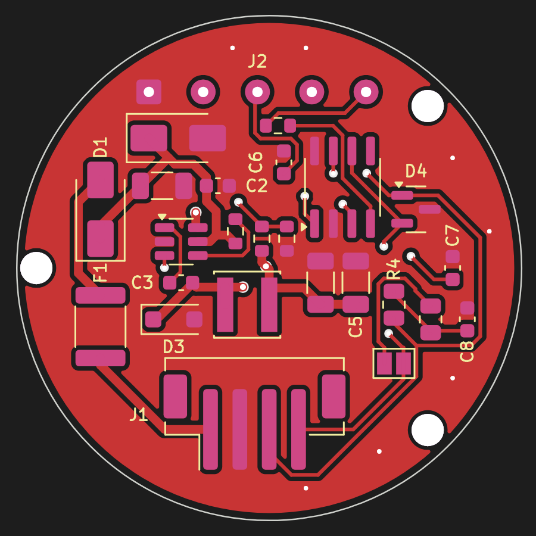

# NOT STOCK CAN 1.32

A round board that sits behind the **Waveshare ESP32-S3-Touch-AMOLED-1.32**
on its three standoffs and turns the car's OBD supply and CAN into what the
gauge needs: 5 V for the display and a CAN transceiver. One 4-wire cable
from the OBD plug; to the display the 12-pin cable that comes with it, five
of its wires soldered to this board. The CAN 1.85 board
([`../notstock-can185`](../notstock-can185)) made smaller, same circuit.



KiCad 7 project: `notstock-can132.kicad_pro` (schematic, PCB), generated from
`tools/design.py`. Schematic: [docs/schematic.pdf](docs/schematic.pdf).
Placement: [docs/assembly.png](docs/assembly.png).

**State: rev 1, designed, DRC clean (0 errors, 0 unconnected), ready to
order with assembly; not built yet.**

## How it connects

The display's 12-pin connector (J1 on the display, side entry, on its top
edge; Waveshare's schematic): 1 GND, 2 VSYS, 3 VCC3V3, 4 GP0, 5 GP1, 6 GP2,
7 SCL, 8 SDA, 9 D-, 10 D+, 11 TXD, 12 RXD.

| Display J1 | This board, J2 (marked on the back) |
| --- | --- |
| 1 GND | GND |
| 2 VSYS | VSYS: 5 V from this board |
| 3 VCC3V3 | 3V3: the transceiver's supply |
| 5 GP1 | IO1: CAN TX |
| 6 GP2 | IO2: CAN RX (through R6 1 k) |
| 4, 7..12 | cut off |

Use the cable that comes with the display: plug it in, cut the wires short,
fold them back over the board's top edge to J2. Which wire is which: count
from the connector's pin 1 (marked on the display), not by colour; with the
display on USB, 3.3 V between the wires of pins 3 and 1.

**Power through VSYS, no battery.** VSYS is the display's system rail
behind its USB diode (D1 on the display) and in front of its 3.3 V
regulator (MP1605, 2.3..5.5 V in). Fed there the display runs with the key,
no battery and no power button (its battery switch, BAT_EN / PWR_KEY, is
bypassed). USB-C stays usable for flashing: the display's own diode keeps
the two 5 V apart. **No battery on the display's BAT socket.**

The car: J1, JST PH 4-pin, vertical, on this board's bottom edge: 12V, GND,
CAN-H, CAN-L (marked on the back). OBD plug: pin 1 +12 V (terminal 15,
switched by the key; on a VW), pin 4 or 5 GND, pin 6 CAN-H, pin 14 CAN-L.
CAN-H and CAN-L twisted. Housing JST PHR-4, crimps SPH-002T-P0.5S.

Firmware: the A4 gauge's ([`../notstock-a4`](../notstock-a4)), CAN on GPIO1
(TX) and GPIO2 (RX) as it has them.

## Mechanics

| | |
| --- | --- |
| Outline | Ø 34.4 mm (the display is 36.4) |
| Holes | the display's standoffs, M2: seen from behind (this board's top) at (-15.87, 0), (10.8, -11.04), (10.8, 11.04) mm from the centre, y down |
| Parts | top side only (away from the display) |

The display's tallest parts (its USB-C and 12-pin connector) end 0.25 mm
short of the standoffs: put **M2 washers or short spacers, 1 to 1.5 mm**,
between the standoffs and this board, and trim J2's wire ends flush on the
back. The 12-pin connector sits right under J2. Hold the printed board
(1:1, `docs/top.svg`) against the display first: the hole positions are
from Waveshare's STEP, not measured.

## What is on it

| Block | Parts |
| --- | --- |
| Input | J1 JST PH 4-pin SMD, vertical; F1 0.5 A resettable fuse; D1 SS16 against reverse polarity; D2 SMAJ26A against load dump |
| 12 V -> 5 V | U1 LMR16006YDDCR (60 V, 0.6 A, 2.1 MHz), L1 22 uH, D3 PMEG6010CEH, 2 x 22 uF out; 56 k / 10 k: 0.765 V x 6.6 = 5.05 V. Under about 5.5 V in (cranking) the output follows the input down; the display's regulator runs from 2.3 V |
| CAN | U2 SN65HVD230 (3.3 V from the display), Rs to GND: full speed; D4 NUP2105L ESD; R4/R5/C8 split termination behind JP1 (TERM), open, not assembled; R6 1 k in RXD |

Termination: JP1 open, R4/R5/C8 not assembled. With the key out, measure
between OBD pins 6 and 14: about 60 R, nothing needed; about 120 R (the
T5.1's diagnostic branch was like that): solder R4 and R5 (0805, 56..62 R)
and bridge JP1, C8 (4.7 nF 0603) optional.

## Make it (JLCPCB, with assembly)

Three files in `fab/`: `notstock-can132-gerbers.zip` (2 layers, 1.6 mm),
`bom.csv` and `cpl.csv` (PCB Assembly, top side). Every assembled part has
its LCSC number in `bom.csv`; R4, R5, C8 (termination) and the wire pads
are not assembled. In the placement preview check the parts with a
direction: U1, U2, D1..D4, J1 (opening upwards).

**R2 is 56 k here (UNI-ROYAL 0603WAF5602T5E, LCSC C23206), 39 k on the
1.85 board.** If it is out of stock, any 56 k 1 % 0603 does (a 5 % one,
C25603, gives 5.05 V +-0.2 V, still inside the display's 5.5 V).

## Regenerate

```
python3 tools/check_place.py                   # courtyards, edge, holes
python3 tools/gen_sch.py                       # the schematic
kicad-cli sch export netlist -o /tmp/n.net notstock-can132.kicad_sch
python3 tools/check_net.py /tmp/n.net          # schematic = design.py
python3 tools/gen_pcb.py --freerouting freerouting-2.0.1.jar
python3 tools/drc_summary.py                   # DRC of the routed board
python3 tools/gen_fab.py                       # fab/ and docs/
```

KiCad 7 (python module and libraries), Java 21, Freerouting 2.x (under
xvfb-run where there is no display; gen_pcb.py does that by itself).
Freerouting is not deterministic: run again if DRC shows an unconnected
item.
