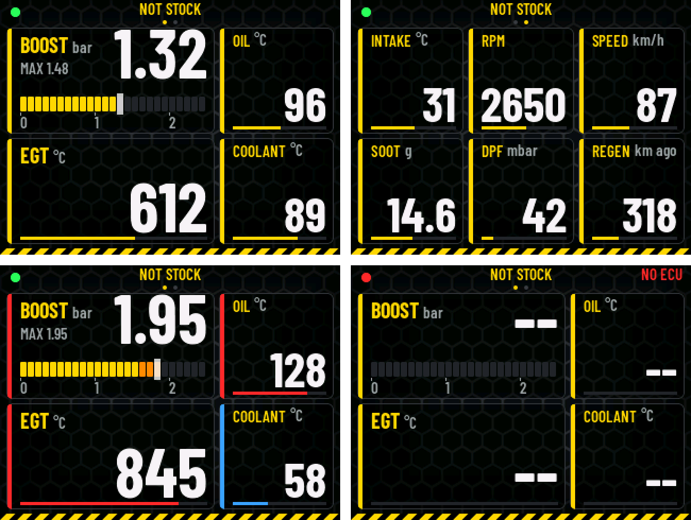

# NOT STOCK 2.8" gauge, VW T5.1 over OBD-II

Waveshare **RP2350-Touch-LCD-2.8** (RP2350, 2.8" IPS 240 x 320 run landscape
320 x 240, ST7789 on SPI, CST328 touch) on the OBD port of a **VW T5.1 2.0
TDI CR** (CAAC, EDC17). It asks the engine ECU like a scan tool, with the
OBD-II / VW UDS client of the 7" dash
([`../notstock-dash-7inch/main/obd2.c`](../notstock-dash-7inch/main/obd2.c):
mode 01 PIDs, oil and EGT as VW measuring values, the particulate filter).
The look is the 2" EMU gauge's ([`../notstock-lcd2-emu`](../notstock-lcd2-emu)):
honeycomb, cards, NOT STOCK yellow; its background, logo and fonts are
used from there.



Page 1, page 2, past the limits (coolant still cold), no ECU.

**State: built; the pages checked in the simulator. Not tried on the
board yet** (panel set-up, colour order and touch orientation unconfirmed).

## The pages

Swipe left / right. At the top: the link dot (green: the ECU answers,
red: not), NOT STOCK and the page dots, the OBD state on the right (SCAN
while it asks which PIDs exist, NO ECU in red when nobody answers).

- **Page 1**: BOOST (MAP minus baro, an LED bar of 0.1 bar segments, the
  white cap is the MAX since power-on), EGT (sensor 1, before the turbo),
  OIL, COOLANT.
- **Page 2**: INTAKE, RPM, SPEED, SOOT (calculated, g), DPF (differential
  pressure, mbar), REGEN (km since the last regeneration).

| Value | Orange | Red |
| --- | --- | --- |
| BOOST | from 1.6 bar | from 1.9 |
| EGT | from 750 degC | from 830 |
| OIL | from 115; blue under 60 | from 125 |
| COOLANT | from 100; blue under 60 | from 108 |
| INTAKE | from 50 | from 65 |
| RPM | from 4200 | from 4600 |
| SOOT | from 20 g | from 24 (a guess until a regeneration is seen) |

Limits and ranges: `CH[]` in `main/ui_t5.c`.

## Board

Pins from Waveshare's schematic (its pin table; `main/hw_l28.h`):

| What | GPIO |
| --- | --- |
| LCD SPI1: SCK, MOSI, (MISO), CS, DC, RST | 10, 11, (12), 13, 14, 15 |
| Backlight (PWM, through a MOSFET) | 16 |
| I2C1 SDA, SCL: touch CST328 0x1A, IMU QMI8658, RTC PCF85063 | 6, 7 |
| Touch RST, INT | 17, 18 |
| I2S to the PCM5101A: BCK, LRCK, DIN | 2, 3, 4 |
| SD card | 19 .. 24 |
| Battery: key, enable, ADC | 25, 26, 27 |
| Free: UART connector, 12-pin FPC | 0, 1, 28, 29 |

Build options (`cmake -D...`): `L28_FLIP=1` the picture upside down,
`L28_BGR=1` if red and blue come out swapped, `T5_CAN_SWAP=1` for CTX on
GPIO1 and CRX on GPIO0. The log prints the first touches raw and mapped:
the thing to send if a tap lands in the wrong place. No battery: with one,
the board would run on after the ignition is off.

## CAN and wiring

The RP2350 has no CAN controller: [can2040](https://github.com/KevinOConnor/can2040)
(`../notstock-lcd2-emu/third_party/can2040`, **GNU GPLv3**) is one in
software on PIO0, at a fixed 500 kbit. Received answers (0x7E8..0x7EF) are
queued in its interrupt and handed to the OBD client from the main loop.

| From | To |
| --- | --- |
| UART connector 3V3 | SN65HVD230 3V3 |
| UART connector GND | SN65HVD230 GND |
| GPIO0 (UART connector) | SN65HVD230 CTX |
| GPIO1 (UART connector) | SN65HVD230 CRX |
| SN65HVD230 CANH / CANL | OBD pin 6 / 14 |
| GND | OBD pin 4 or 5 |
| 5 V (USB-C) | a 12 -> 5 V converter on switched 12 V |

The GPIO numbers count, not the connector's TXD / RXD labels (Waveshare's
pictures disagree on them). As on the 7" dash: if nothing answers, the
diagnostic branch may want termination, a 120 R across CANH / CANL.

The log (USB serial) every 3 s: the OBD state, requests / answers /
timeouts, can2040's frame counts and the values.

## Build, flash, simulator

```
cmake -S . -B build -G Ninja -DPICO_SDK_PATH=/path/to/pico-sdk -DLVGL_DIR=/path/to/lvgl-8.4
cmake --build build
```

Flash: hold BOOT, plug the USB-C in, copy `build/notstock_lcd28_t5.uf2`
to the drive that shows up.

```
make -C tools/sim LVGL_DIR=/path/to/lvgl-8.4
tools/sim/build/sim out.ppm boost=1.45 egt=780 page=0
```

Inputs: see `tools/sim/sim.c`.
