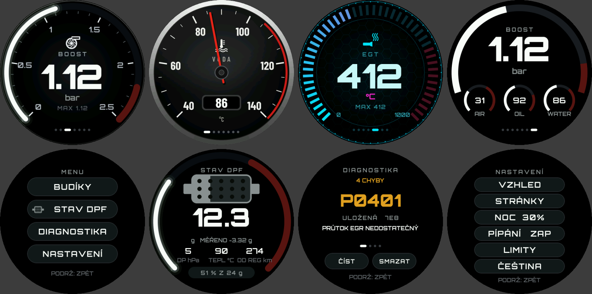

# NOT STOCK round gauge, LCD 1.85"

The round gauge of [`../notstock-round`](../notstock-round) on the Waveshare
**ESP32-S3-Touch-LCD-1.85** (360 x 360 LCD, ST77916 over QSPI, CST816
touch, PCM5101 audio with a speaker). Same UI, pages, looks, MULTI, DPF
status, diagnostics, settings and OBD/CAN code: this project builds the
sources of `../notstock-round/main` with its own board layer,
`main/hw_lcd185.c`, and Espressif's ST77916 driver (`main/st77916`, as in
Waveshare's demo).

The power and CAN board that sits behind it:
[`../notstock-can185`](../notstock-can185).

Not yet run on the board: built, and the scaled UI checked against the
simulator's frames. Pins from Waveshare's schematic of this board.

## One UI, scaled

The UI is laid out for 480 x 480. Here LVGL renders into a 480 x 480 frame
in PSRAM and every refresh goes to the panel scaled to 360 x 360: each
4 x 4 block of pixels becomes 3 x 3, area-weighted, so lines and text stay
smooth; only the part that changed is scaled and sent. The touch is scaled
the other way. Nothing in the UI knows about it.



## Build and flash

ESP-IDF 5.x, from this folder:

```
idf.py set-target esp32s3
idf.py build
```

The flash holds two apps (`partitions.csv`): this gauge in `ota_0` and,
in `factory`, the Wi-Fi updater ([`../notstock-updater185`](../notstock-updater185)).
The first time, over the board's USB-C (the ESP32-S3's own USB; unplug the
CAN board's battery wires from the display first), both, with the
updater built too:

```
esptool.py --chip esp32s3 -b 460800 write_flash --flash_mode dio --flash_size 16MB --flash_freq 80m \
  0x0 build/bootloader/bootloader.bin 0x8000 build/partition_table/partition-table.bin \
  0xf000 build/ota_data_initial.bin 0x20000 ../notstock-updater185/build/notstock_updater185.bin \
  0x200000 build/notstock_round_lcd185.bin
```

Not `idf.py flash`: it would put the gauge at the first app partition,
the updater's (the build's warning that one app partition is too small
for it says the same). After that, over Wi-Fi: MENU -> AKTUALIZACE ->
SPUSTIT, then on a phone the network NOTSTOCK-185 (password notstock),
http://192.168.4.1, and `build/notstock_round_lcd185.bin` uploaded there.

## Pins

All in `main/board_lcd185.h`:

- ST77916: CLK 40, D0..3 46/45/42/41, CS 21; reset on the TCA9554's EXIO2;
  backlight PWM on GPIO5.
- I2C GPIO10/11: TCA9554 0x20, IMU, RTC. The CST816 touch (0x15, INT
  GPIO4, reset EXIO1) is on GPIO1/3 on this board; it is looked for on
  10/11 first, where later boards have it.
- PCM5101: BCK 48, LRCK 38, DOUT 47. The beeps (a 2.4 kHz tone) or the
  chime, gong or voice picked in SETTINGS -> SOUND, as PCM. Loudness:
  `BEEP_AMP` in `hw_lcd185.c`.
- CAN: through the display's 4-pin 1.0 mm UART socket, on the cable that
  comes with the display, soldered to the CAN board: GPIO44 (socket pin 1, RXD) is CAN TX, GPIO43
  (pin 2, TXD) CAN RX. The console is on the USB; the boot loader is quiet.
- Power: 3.75 V into the display's battery socket from the CAN board, with
  the display's power button (Key1) bridged; see `../notstock-can185`.

The panel comes in two revisions with different set-up tables; the ID read
at start picks one, as Waveshare's demo does, and the log says which.

## In the VW T5 vent

`cad/vent_t5_185.py` turns the T5 vent gauge holder (52 mm ring, an STL
from its 3MF) into a housing for this display with the CAN 1.85 board
behind it: a tube round the display, its face flush with the louvers', no
lip (bore 56 mm, the display goes in from the front, past what stands
out at its edge, onto three sleeves on ribs inside the tube, the glass
then flush with the face), and a lid at the back
with a window for the board's 4-pin JST, nothing else showing.

The stack is held by three M2 x 12 screws through the display's own three
standoffs: lid boss floor (1.5) | CAN board (1.6) | the tube's sleeve
(5.9) | standoff (the screw 3 mm into its 4). The
bosses are 8.4 mm tall, the screws go in from the back down a 4.3 mm bore
in each, so the lid stands off the board and leaves room for the
display's speaker: glued inside the lid over its sound holes (a raised
ring, open at the wire lug, marks the place), its wire round the CAN
board's edge to the display's 2-pin socket. Made for a 30 x 20 x 5 mm
oval lying across. The display goes in from the front onto the sleeves, the
CAN board and the lid from the back, the screws through all of it: the
lid's skirt also holds in the tube on six crush ribs. Print the vent or
the tube face down with support under the three sleeves. 26.7 mm deep in all behind the face. The display's USB-C is
inside: update over Wi-Fi (MENU > AKTUALIZACE) or pull the lid out.

`tube185.stl` is the same tube alone, no vent round it (60.8 mm across,
24.7 deep), to put the gauge anywhere, with the same lid.

In the vent the display is turned to the driver: 15 degrees to the right
(the gauge in the left vent by the door) and 10 degrees down, about the
middle of its face, then moved out 6 mm along its axis. The tube stands
out of the louvers by up to 15.5 mm at its top left, its other side 3.8 mm
behind them; the louvers in front of it are cut back in a 40 degree cone,
so they shade nothing. At the back it stays inside the holder. The front
is no longer flat: print the vent on its left side plate, with support in
the tube. The side plates' corners are rounded in their own plane
(`CORNER_R`, 5 mm), as the dash's opening.

`python3 cad/vent_t5_185.py DIR [UP] [SPK_T] [SPK_L] [SPK_W] [YAW] [PITCH] [PUSH]` with
`holder.stl` and `disp185.stl` (Waveshare's STEP as STL) in DIR; writes
`vent185.stl`, `tube185.stl`, `lid185.stl` and `fit185.txt`. Without
`holder.stl` it makes the tube and the lid only (they do not need it),
without `disp185.stl` it skips the display's fit checks. The tube and the
lid as made, STL and STEP (`cad/stl2step.py`), are in `cad/out/`; the vent
needs the holder's 3MF, which is not in the repository. UP = -1 turns the display half round in the vent (J1 at
the bottom); SPK_T, SPK_L and SPK_W are the speaker's thickness, length
and width in mm (5, 30, 20); YAW and PITCH the turn in degrees, to the
right and down (15, 10; 0 0 for straight), PUSH how far out (6 mm). Needs trimesh and manifold3d.

## If something is off

The console logs the I2C devices found (0x15 touch, 0x20 TCA9554, 0x51 RTC,
0x6B IMU), the panel ID, "CST816 ready", "PCM5101 ready". A missing one
points at that part; send the log.
